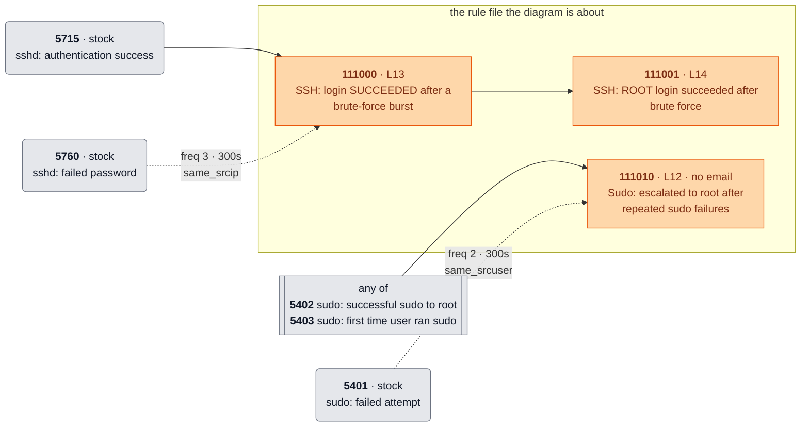
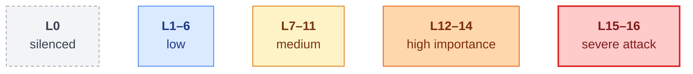
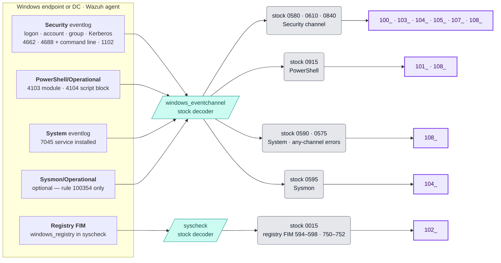
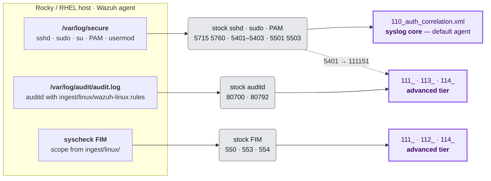
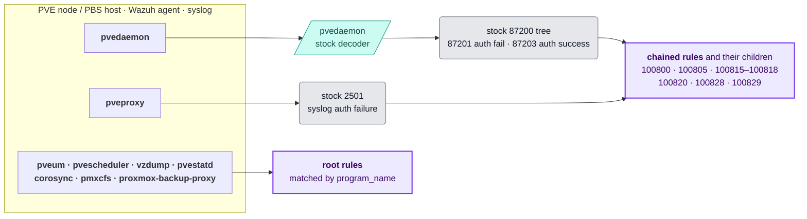
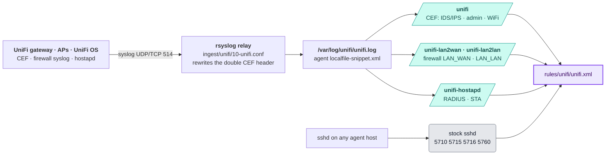

# Rule diagrams

Pictures of how the detections in this repository fit together: where each platform's
events come from, and how every rule chains onto its parents. GitHub renders the
diagrams inline.

| Page | Covers |
|---|---|
| [Windows / Active Directory](windows.md) | `rules/windows/` — 8 files, load-order chains between them |
| [Linux (Rocky / RHEL-family)](linux.md) | `rules/linux/` — syslog core vs. auditd / FIM tier |
| [Proxmox VE + PBS](proxmox.md) | `rules/proxmox/` — stock 87200 tree vs. `program_name` roots |
| [UniFi](unifi.md) | `rules/unifi/` — CEF, firewall and hostapd decoders |
| [Experimental](experimental.md) | `experimental/` — cross-device correlation, **not deployed** |

Each page opens with a **file map** (which stock rulesets feed which file, and which
files chain onto each other) and then has one **chain diagram** per rule file.

The platform pages are generated from the rule XML by
[`.github/scripts/rule_diagrams.py`](../../.github/scripts/rule_diagrams.py) — do not edit
them by hand. After changing a rule file:

```bash
python3 .github/scripts/rule_diagrams.py            # rewrite the pages
python3 .github/scripts/rule_diagrams.py --check    # what CI runs: fails if a page is stale
```

This page — the legend and the collection paths below — is hand-written.

## Legend



Read that as: *111000 fires on an sshd success (5715) when 5760 has also matched from the
same source IP within 300 s; 111001 is the subset of those that were root logins.*

**Arrows**

| Arrow | XML | Meaning |
|---|---|---|
| solid `A → B` | `<if_sid>A</if_sid>` / `<if_group>` / `<decoded_as>` | B looks at the **same event** A matched and narrows it down. |
| dotted, labelled `A ⇢ B` | `<if_matched_sid>A</if_matched_sid>` / `<if_matched_group>` | A matched on **earlier events**. The label is the rule's `frequency` / `timeframe` and the `same_*` / `different_*` fields that tie those events together. |
| thick, file map only | — | a file chains onto a custom rule defined in another file, so the arrow's tail must load first. |
| dotted "overwrites", file map only | `overwrite="yes"` | one file re-levels stock rules that another file's rules hang off. |

The solid/dotted split is the gotcha in [`docs/linux.md`](../linux.md#if_sid--if_group-match-the-same-event-not-afterwards):
a chain of solid arrows never means "B happened after A". Also note that `frequency`
fires later than the number reads — see
[the same doc](../linux.md#frequency-fires-later-than-it-reads).

**Boxes**

| Box | Meaning |
|---|---|
| grey, rounded | stock Wazuh rule, labelled from the 4.14.3 ruleset |
| grey, double-sided "any of" | a multi-id `<if_sid>` list — any one of these parents |
| violet | a rule from another file in this repo, or a stock rule this repo overwrites |
| teal parallelogram | the decoder or `program_name` a root rule matches on |
| teal hexagon | a rule group (`if_group` / `if_matched_group`) |
| `no email` | `<options>no_email_alert</options>` — dashboard only |
| `overwrite` | `overwrite="yes"` — this rule replaces a stock rule's definition |

**Colour = level**, using Wazuh's own bands:



Descriptions are shortened for the diagram: `$(field)` interpolations are dropped, or
kept as `‹field›` where the sentence needs them. The rule file is always the source of
truth.

## How events reach the rules

Rules only fire on events the collection side delivers. These are the paths each
platform's events take before they reach a chain diagram — hand-drawn from
[`ingest/`](../../ingest/README.md) and the per-platform docs.

### Windows / Active Directory



No Sysmon needed except for 100354. DCSync (100332, event 4662) also needs DC-side audit
config — see [`docs/windows.md`](../windows.md#dcsync-100332-requires-dc-side-audit-config).

### Linux (Rocky / RHEL-family)



Without the auditd rules and FIM scope from [`ingest/linux/`](../../ingest/README.md#linux),
32 of the 40 Linux rules stay silent. The `audit.key` values in `wazuh-linux.rules` must match
the rules exactly.

### Proxmox VE + PBS



Stock 87200 claims every pvedaemon event first, so a custom *root* rule for pvedaemon
would never fire — which is why that half of `proxmox.xml` chains instead. See
[`docs/proxmox.md`](../proxmox.md#stock-rule-87200-shadows-custom-root-rules). The optional
`decoders/proxmox/` adds fields for the dashboards; no rule here uses `decoded_as` on it.

### UniFi



UniFi devices cannot run an agent, so everything goes through the relay. The decoders
live in [`decoders/unifi/unifi.xml`](../../decoders/unifi/unifi.xml). Rules 100720 / 100725
are generic sshd rules that happen to live in this file — they are not UniFi-specific.
