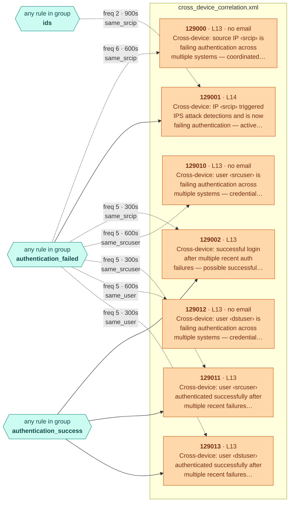

<!-- Generated by .github/scripts/rule_diagrams.py from experimental/ — do not edit by hand. -->
# Experimental — not deployed — rule chains

Every rule in [`experimental/`](../../experimental/) and what it chains onto. Read the [legend](README.md#legend) first; regenerate with `python3 .github/scripts/rule_diagrams.py` after changing a rule file.

> **Not deployed.** These rules are kept for reference and have known gaps on 4.14.x — see [`experimental/README.md`](../../experimental/README.md).

| File | Rules | Correlation | Overwrite | Levels |
|---|---:|---:|---:|---|
| [`cross_device_correlation.xml`](#cross_device_correlationxml) | 7 | 7 | 0 | 13–14 |

## File map

Where each file's events come from.

## cross_device_correlation.xml

[`experimental/cross_device_correlation.xml`](../../experimental/cross_device_correlation.xml) · 7 rules

