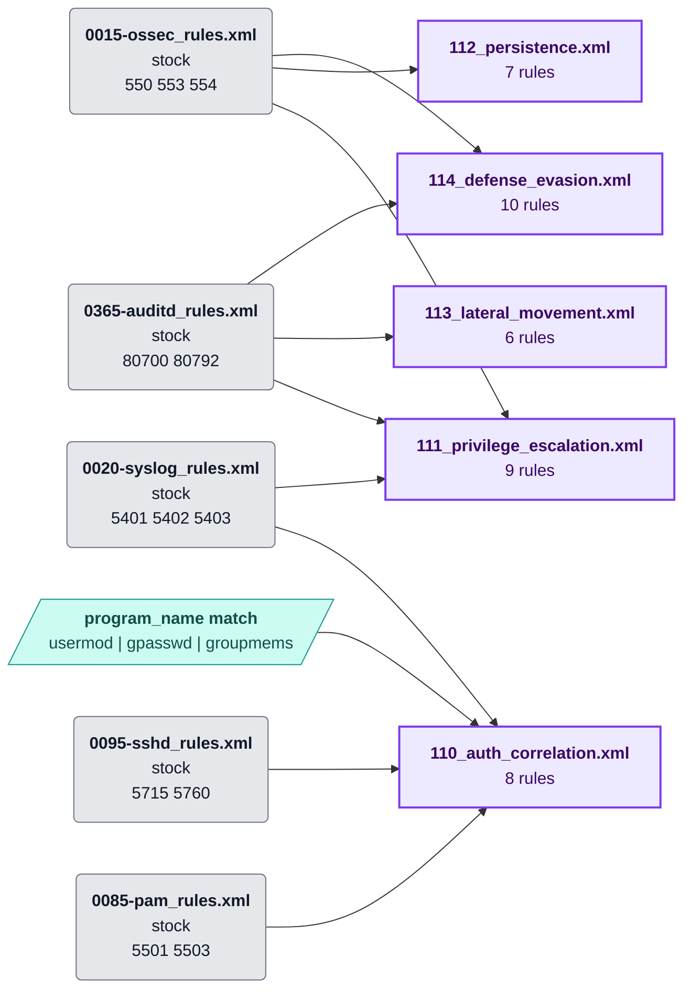
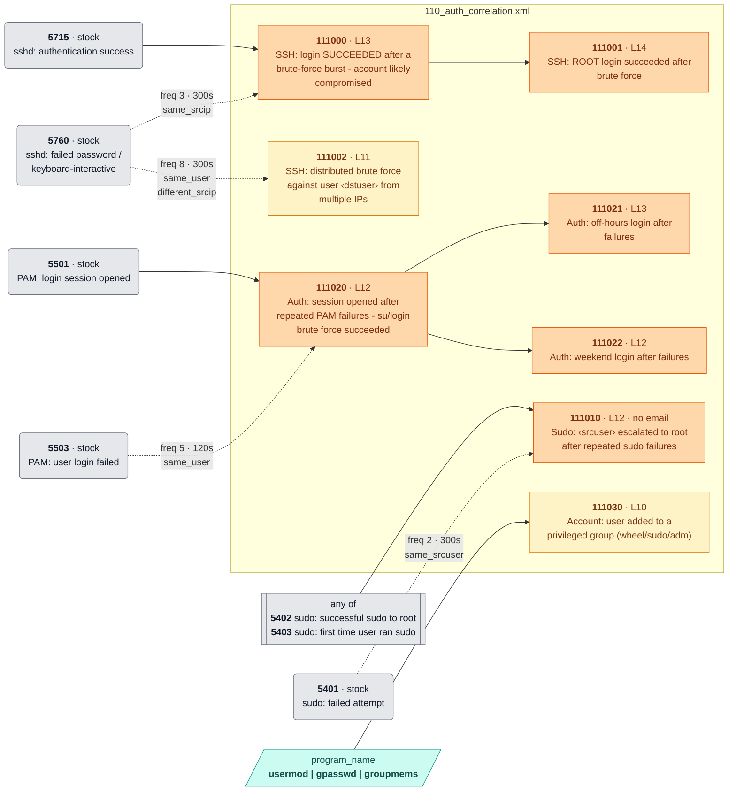
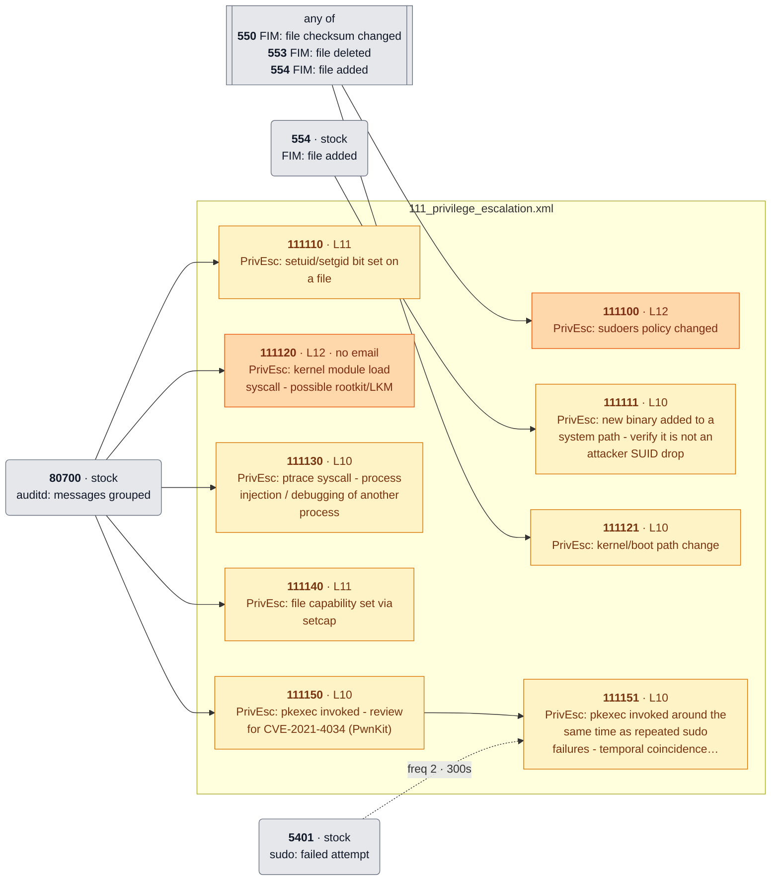
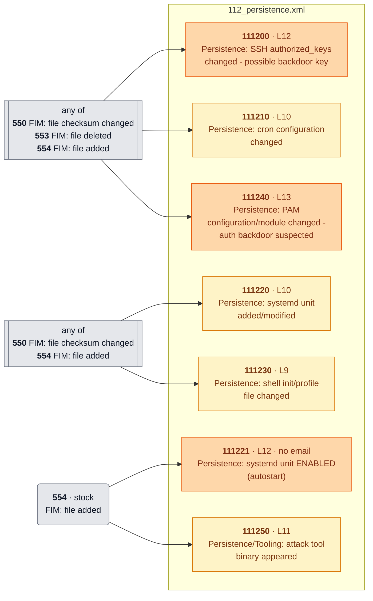
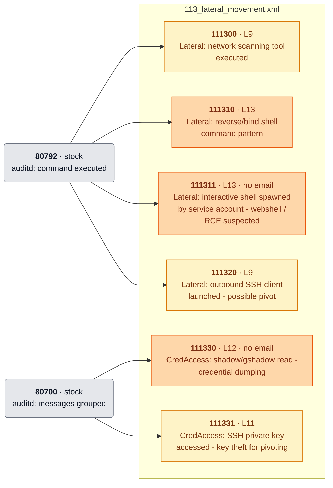
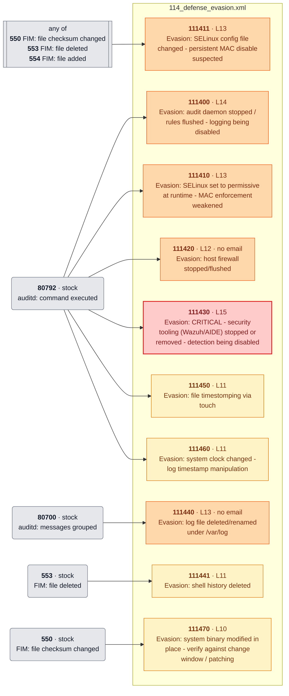

<!-- Generated by .github/scripts/rule_diagrams.py from rules/linux/ — do not edit by hand. -->
# Linux (Rocky / RHEL-family) — rule chains

Every rule in [`rules/linux/`](../../rules/linux/) and what it chains onto. Read the [legend](README.md#legend) first; regenerate with `python3 .github/scripts/rule_diagrams.py` after changing a rule file.

| File | Rules | Correlation | Overwrite | Levels |
|---|---:|---:|---:|---|
| [`110_auth_correlation.xml`](#110_auth_correlationxml) | 8 | 4 | 0 | 10–14 |
| [`111_privilege_escalation.xml`](#111_privilege_escalationxml) | 9 | 1 | 0 | 10–12 |
| [`112_persistence.xml`](#112_persistencexml) | 7 | 0 | 0 | 9–13 |
| [`113_lateral_movement.xml`](#113_lateral_movementxml) | 6 | 0 | 0 | 9–13 |
| [`114_defense_evasion.xml`](#114_defense_evasionxml) | 10 | 0 | 0 | 10–15 |
| `115_alert_tuning.xml` | 0 | — | — | no active rules |

## File map

Where each file's events come from.

## 110_auth_correlation.xml

[`rules/linux/110_auth_correlation.xml`](../../rules/linux/110_auth_correlation.xml) · 8 rules

## 111_privilege_escalation.xml

[`rules/linux/111_privilege_escalation.xml`](../../rules/linux/111_privilege_escalation.xml) · 9 rules

## 112_persistence.xml

[`rules/linux/112_persistence.xml`](../../rules/linux/112_persistence.xml) · 7 rules

## 113_lateral_movement.xml

[`rules/linux/113_lateral_movement.xml`](../../rules/linux/113_lateral_movement.xml) · 6 rules

## 114_defense_evasion.xml

[`rules/linux/114_defense_evasion.xml`](../../rules/linux/114_defense_evasion.xml) · 10 rules

