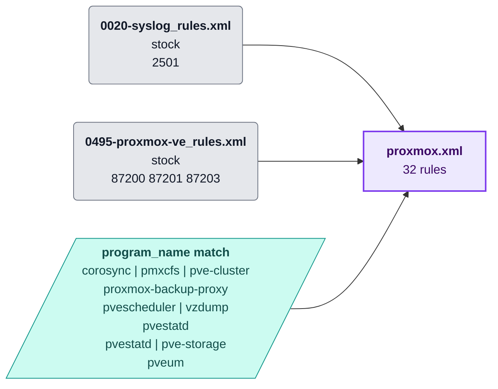

<!-- Generated by .github/scripts/rule_diagrams.py from rules/proxmox/ — do not edit by hand. -->
# Proxmox VE + PBS — rule chains

Every rule in [`rules/proxmox/`](../../rules/proxmox/) and what it chains onto. Read the [legend](README.md#legend) first; regenerate with `python3 .github/scripts/rule_diagrams.py` after changing a rule file.

| File | Rules | Correlation | Overwrite | Levels |
|---|---:|---:|---:|---|
| [`proxmox.xml`](#proxmoxxml) | 32 | 7 | 0 | 2–12 |

## File map

Where each file's events come from.

## proxmox.xml

[`rules/proxmox/proxmox.xml`](../../rules/proxmox/proxmox.xml) · 32 rules

```mermaid
%%{init: {"flowchart": {"wrappingWidth": 400}}}%%
flowchart LR
  subgraph F["proxmox.xml"]
    r100800["<b>100800</b> · L5<br/>Proxmox VE – Authentication<br/>failure (pvedaemon/pveproxy) –<br/>credential probing against web UI…"]:::sev1
    r100801["<b>100801</b> · L10<br/>Proxmox VE – Brute force detected:<br/>5+ auth failures in 120s<br/>(pvedaemon) – sustained credential…"]:::sev7
    r100805["<b>100805</b> · L3<br/>Proxmox VE – Successful<br/>authentication (pvedaemon)"]:::sev1
    r100806["<b>100806</b> · L12<br/>Proxmox VE – Login SUCCEEDED after<br/>prior brute force – likely<br/>compromised credentials."]:::sev12
    r100807["<b>100807</b> · L8<br/>Proxmox VE – root@pam login –<br/>privileged infrastructure account<br/>use"]:::sev7
    r100810["<b>100810</b> · L8<br/>Proxmox VE – New user created or<br/>added to admin group (pveum) –<br/>possible persistence"]:::sev7
    r100811["<b>100811</b> · L6<br/>Proxmox VE – User account deleted<br/>(pveum) – account access removal<br/>audit"]:::sev1
    r100815["<b>100815</b> · L10<br/>Proxmox VE – VM/CT DELETED<br/>(pvedaemon) – destructive<br/>operation / data loss risk"]:::sev7
    r100816["<b>100816</b> · L3<br/>Proxmox VE – VM/CT created<br/>(pvedaemon) – provisioning audit"]:::sev1
    r100817["<b>100817</b> · L7<br/>Proxmox VE – VM/CT migrated to<br/>another node (pvedaemon) – data<br/>movement"]:::sev7
    r100818["<b>100818</b> · L7<br/>Proxmox VE – Snapshot DELETED<br/>(delsnapshot, pvedaemon) – inhibit<br/>recovery"]:::sev7
    r100820["<b>100820</b> · L3<br/>Proxmox VE – VM/CT lifecycle<br/>operation (pvedaemon) – operation<br/>audit"]:::sev1
    r100821["<b>100821</b> · L9<br/>Proxmox VE – Mass VM operations:<br/>5+ VM/CT actions in 60s on one<br/>node – possible mass destruction /…"]:::sev7
    r100825["<b>100825</b> · L8<br/>Proxmox VE – Backup (vzdump)<br/>FAILED – backup integrity at risk"]:::sev7
    r100826["<b>100826</b> · L10<br/>Proxmox VE – Consecutive vzdump<br/>failures (2+ in 1h) on one node –<br/>systematic backup failure /…"]:::sev7
    r100827["<b>100827</b> · L2<br/>Proxmox VE – Backup (vzdump)<br/>completed successfully"]:::sev1
    r100828["<b>100828</b> · L8<br/>Proxmox VE – Backup (vzdump)<br/>FAILED (via pvedaemon task) –<br/>backup integrity at risk"]:::sev7
    r100829["<b>100829</b> · L10<br/>Proxmox VE – Storage pool became<br/>UNAVAILABLE (via pvedaemon) – data<br/>availability impact"]:::sev7
    r100830["<b>100830</b> · L10<br/>Proxmox VE – Storage pool became<br/>UNAVAILABLE – data availability<br/>impact"]:::sev7
    r100831["<b>100831</b> · L7<br/>Proxmox VE – Storage low disk<br/>space warning – capacity risk"]:::sev7
    r100832["<b>100832</b> · L9<br/>Proxmox VE – Cluster event: node<br/>unreachable / quorum lost –<br/>infrastructure availability impact"]:::sev7
    r100850["<b>100850</b> · L5<br/>PBS – Authentication failure<br/>(proxmox-backup-proxy) –<br/>credential probing"]:::sev1
    r100851["<b>100851</b> · L10<br/>PBS – Brute force detected: 5+<br/>auth failures in 120s – sustained<br/>credential attack."]:::sev7
    r100855["<b>100855</b> · L3<br/>PBS – Successful authentication<br/>(proxmox-backup-proxy)"]:::sev1
    r100856["<b>100856</b> · L12<br/>PBS – Login SUCCEEDED after prior<br/>brute force – likely compromised<br/>credentials."]:::sev12
    r100857["<b>100857</b> · L9<br/>PBS – Failed login attempt from<br/>EXTERNAL (non-RFC1918) IP –<br/>unexpected remote backup-server…"]:::sev7
    r100860["<b>100860</b> · L8<br/>PBS – Backup FAILED – backup<br/>integrity at risk"]:::sev7
    r100861["<b>100861</b> · L10<br/>PBS – Consecutive backup failures<br/>(3+ in 1h) – systematic backup<br/>failure / inhibit recovery."]:::sev7
    r100862["<b>100862</b> · L2<br/>PBS – Backup finished successfully"]:::sev1
    r100865["<b>100865</b> · L6<br/>PBS – Prune removed an unusually<br/>large number of snapshots (10+) –<br/>possible inhibit recovery"]:::sev1
    r100866["<b>100866</b> · L7<br/>PBS – Garbage collection FAILED –<br/>storage maintenance issue"]:::sev7
    r100867["<b>100867</b> · L10<br/>PBS – Datastore is UNAVAILABLE –<br/>backup data availability impact"]:::sev7
  end
  any_87201_2501[["any of<br/><b>87201</b> Proxmox VE: authentication failed<br/><b>2501</b> syslog: user authentication failure"]]:::stock
  s87203("<b>87203</b> · stock<br/>Proxmox VE: authentication<br/>succeeded"):::stock
  p_pveum[/"program_name<br/><b>pveum</b>"/]:::src
  s87200("<b>87200</b> · stock<br/>pvedaemon: messages grouped"):::stock
  p_pvescheduler_vzdump[/"program_name<br/><b>pvescheduler | vzdump</b>"/]:::src
  p_pvestatd_pve_storage[/"program_name<br/><b>pvestatd | pve-storage</b>"/]:::src
  p_pvestatd[/"program_name<br/><b>pvestatd</b>"/]:::src
  p_corosync_pmxcfs_pve_cluster[/"program_name<br/><b>corosync | pmxcfs | pve-cluster</b>"/]:::src
  p_proxmox_backup_proxy[/"program_name<br/><b>proxmox-backup-proxy</b>"/]:::src
  any_87201_2501 --> r100800
  r100800 -.->|"freq 5 · 120s"| r100801
  s87203 --> r100805
  r100805 --> r100806
  r100801 -.-> r100806
  r100805 --> r100807
  p_pveum --> r100810
  p_pveum --> r100811
  s87200 --> r100815
  s87200 --> r100816
  s87200 --> r100817
  s87200 --> r100818
  s87200 --> r100820
  r100820 -.->|"freq 5 · 60s"| r100821
  p_pvescheduler_vzdump --> r100825
  r100825 -.->|"freq 2 · 3600s"| r100826
  p_pvescheduler_vzdump --> r100827
  s87200 --> r100828
  s87200 --> r100829
  p_pvestatd_pve_storage --> r100830
  p_pvestatd --> r100831
  p_corosync_pmxcfs_pve_cluster --> r100832
  p_proxmox_backup_proxy --> r100850
  r100850 -.->|"freq 5 · 120s"| r100851
  p_proxmox_backup_proxy --> r100855
  r100855 --> r100856
  r100851 -.-> r100856
  p_proxmox_backup_proxy --> r100857
  p_proxmox_backup_proxy --> r100860
  r100860 -.->|"freq 3 · 3600s"| r100861
  p_proxmox_backup_proxy --> r100862
  p_proxmox_backup_proxy --> r100865
  p_proxmox_backup_proxy --> r100866
  p_proxmox_backup_proxy --> r100867
  classDef sev0 fill:#f3f4f6,stroke:#9ca3af,color:#374151,stroke-dasharray:4 3
  classDef sev1 fill:#dbeafe,stroke:#3b82f6,color:#1e3a8a
  classDef sev7 fill:#fef3c7,stroke:#d97706,color:#78350f
  classDef sev12 fill:#fed7aa,stroke:#ea580c,color:#7c2d12
  classDef sev15 fill:#fecaca,stroke:#dc2626,color:#7f1d1d,stroke-width:2px
  classDef stock fill:#e5e7eb,stroke:#6b7280,color:#111827
  classDef xfile fill:#ede9fe,stroke:#7c3aed,color:#3b0764
  classDef src fill:#ccfbf1,stroke:#0d9488,color:#134e4a
```

