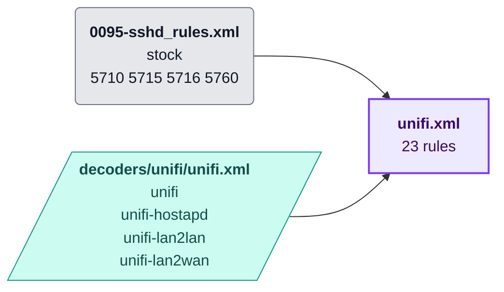
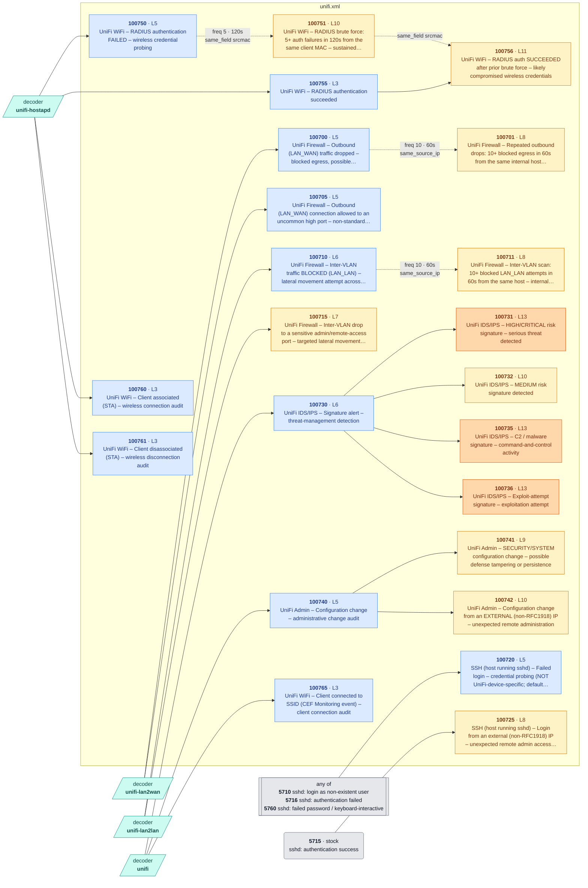

<!-- Generated by .github/scripts/rule_diagrams.py from rules/unifi/ — do not edit by hand. -->
# UniFi — rule chains

Every rule in [`rules/unifi/`](../../rules/unifi/) and what it chains onto. Read the [legend](README.md#legend) first; regenerate with `python3 .github/scripts/rule_diagrams.py` after changing a rule file.

| File | Rules | Correlation | Overwrite | Levels |
|---|---:|---:|---:|---|
| [`unifi.xml`](#unifixml) | 23 | 4 | 0 | 3–13 |

## File map

Where each file's events come from.

## unifi.xml

[`rules/unifi/unifi.xml`](../../rules/unifi/unifi.xml) · 23 rules

