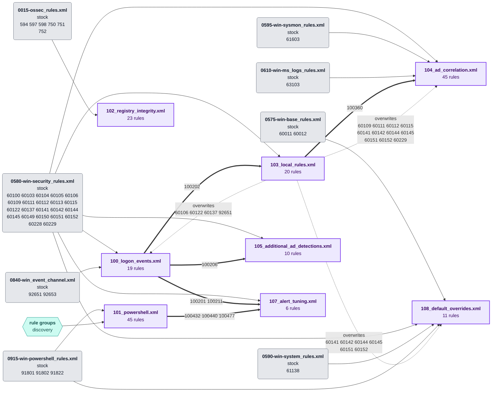
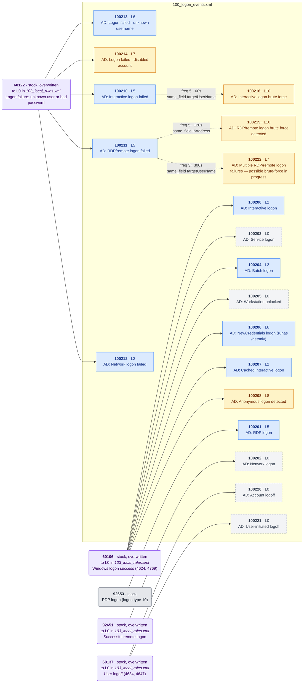
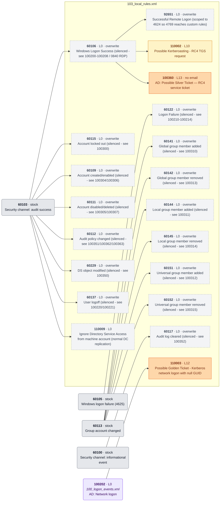
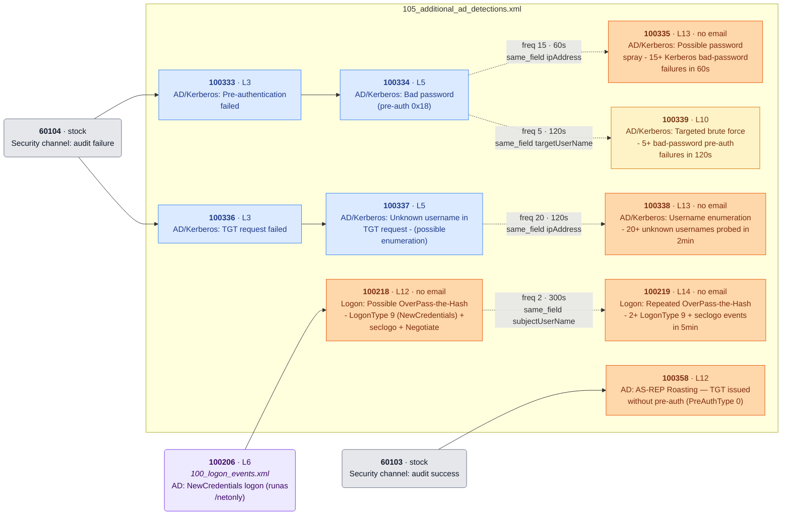
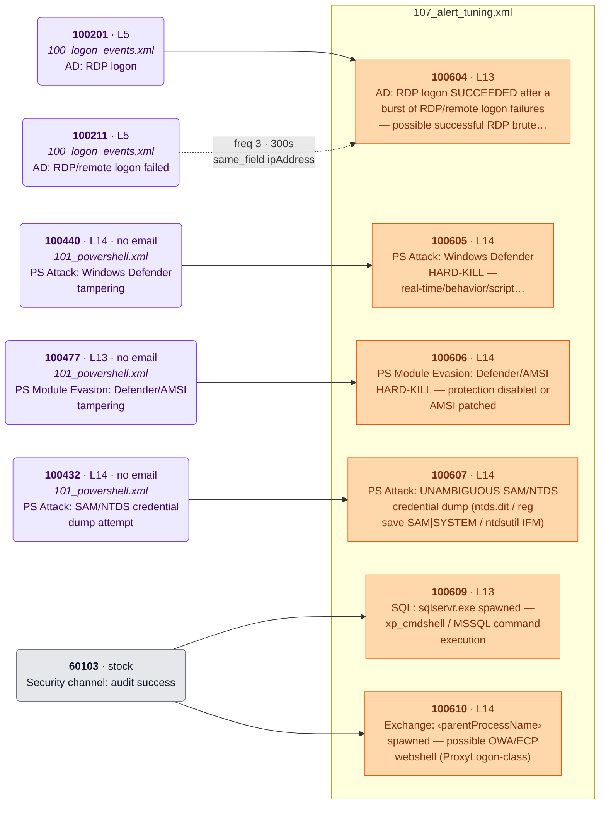
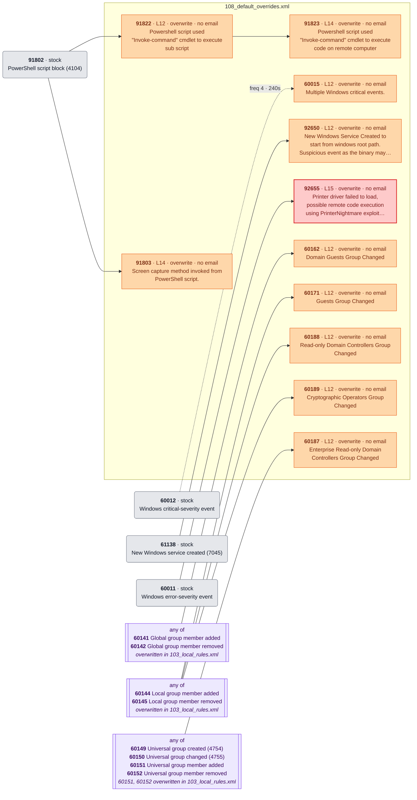

<!-- Generated by .github/scripts/rule_diagrams.py from rules/windows/ — do not edit by hand. -->
# Windows / Active Directory — rule chains

Every rule in [`rules/windows/`](../../rules/windows/) and what it chains onto. Read the [legend](README.md#legend) first; regenerate with `python3 .github/scripts/rule_diagrams.py` after changing a rule file.

| File | Rules | Correlation | Overwrite | Levels |
|---|---:|---:|---:|---|
| [`100_logon_events.xml`](#100_logon_eventsxml) | 19 | 3 | 0 | 0–10 |
| [`101_powershell.xml`](#101_powershellxml) | 45 | 2 | 0 | 0–15 |
| [`102_registry_integrity.xml`](#102_registry_integrityxml) | 23 | 0 | 0 | 10–15 |
| [`103_local_rules.xml`](#103_local_rulesxml) | 20 | 0 | 16 | 0–13 |
| [`104_ad_correlation.xml`](#104_ad_correlationxml) | 45 | 6 | 4 | 2–15 |
| [`105_additional_ad_detections.xml`](#105_additional_ad_detectionsxml) | 10 | 4 | 0 | 3–14 |
| [`107_alert_tuning.xml`](#107_alert_tuningxml) | 6 | 1 | 0 | 13–14 |
| [`108_default_overrides.xml`](#108_default_overridesxml) | 11 | 1 | 11 | 12–15 |

## File map

Where each file's events come from. Thick arrows are chains onto a custom rule in another file, so the arrow's tail must load first — Wazuh loads rule files alphabetically. Dotted arrows mark stock rules that one file overwrites and another file's rules hang off.

## 100_logon_events.xml

[`rules/windows/100_logon_events.xml`](../../rules/windows/100_logon_events.xml) · 19 rules

## 101_powershell.xml

[`rules/windows/101_powershell.xml`](../../rules/windows/101_powershell.xml) · 45 rules

```mermaid
%%{init: {"flowchart": {"wrappingWidth": 400}}}%%
flowchart LR
  subgraph F["101_powershell.xml"]
    r100400["<b>100400</b> · L4<br/>PS Recon: Identity discovery via<br/>whoami"]:::sev1
    r100401["<b>100401</b> · L4<br/>PS Recon: System information<br/>gathering"]:::sev1
    r100402["<b>100402</b> · L4<br/>PS Recon: Network configuration<br/>discovery"]:::sev1
    r100403["<b>100403</b> · L4<br/>PS Recon: Running process<br/>enumeration"]:::sev1
    r100404["<b>100404</b> · L4<br/>PS Recon: Installed software<br/>enumeration"]:::sev1
    r100405["<b>100405</b> · L4<br/>PS Recon: Local user/group<br/>enumeration"]:::sev1
    r100406["<b>100406</b> · L4<br/>PS Recon: Network connection/port<br/>enumeration"]:::sev1
    r100407["<b>100407</b> · L4<br/>PS Recon: Scheduled task<br/>enumeration"]:::sev1
    r100408["<b>100408</b> · L4<br/>PS Recon: Windows service<br/>enumeration"]:::sev1
    r100409["<b>100409</b> · L10<br/>PS Recon: Active host<br/>reconnaissance — multiple<br/>discovery commands"]:::sev7
    r100410["<b>100410</b> · L10<br/>PS Recon: Active Directory user<br/>enumeration"]:::sev7
    r100411["<b>100411</b> · L10<br/>PS Recon: Active Directory group<br/>enumeration"]:::sev7
    r100412["<b>100412</b> · L10<br/>PS Recon: Active Directory<br/>domain/computer enumeration"]:::sev7
    r100413["<b>100413</b> · L10<br/>PS Recon: Active Directory trust<br/>enumeration"]:::sev7
    r100414["<b>100414</b> · L12 · no email<br/>PS Recon: SPN / Kerberoastable<br/>account enumeration"]:::sev12
    r100415["<b>100415</b> · L10<br/>PS Recon: GPO / OU structure<br/>enumeration"]:::sev7
    r100420["<b>100420</b> · L10<br/>PS Recon: Network share<br/>enumeration"]:::sev7
    r100421["<b>100421</b> · L12 · no email<br/>PS Recon: Port scanning activity<br/>detected"]:::sev12
    r100422["<b>100422</b> · L8<br/>PS Recon: DNS reconnaissance"]:::sev7
    r100430["<b>100430</b> · L13<br/>PS Attack: Registry credential<br/>search"]:::sev12
    r100431["<b>100431</b> · L14<br/>PS Attack: LSASS memory access /<br/>credential dump attempt"]:::sev12
    r100432["<b>100432</b> · L14 · no email<br/>PS Attack: SAM/NTDS credential<br/>dump attempt"]:::sev12
    r100433["<b>100433</b> · L12 · no email<br/>PS Attack: Credential file search"]:::sev12
    r100440["<b>100440</b> · L14 · no email<br/>PS Attack: Windows Defender<br/>tampering"]:::sev12
    r100441["<b>100441</b> · L14 · no email<br/>PS Attack: Event log clearing"]:::sev12
    r100442["<b>100442</b> · L15<br/>PS Attack: AMSI bypass attempt"]:::sev15
    r100443["<b>100443</b> · L10<br/>PS Attack: PowerShell execution<br/>policy bypass"]:::sev7
    r100450["<b>100450</b> · L12 · no email<br/>PS Persistence: Scheduled task<br/>creation"]:::sev12
    r100451["<b>100451</b> · L12 · no email<br/>PS Persistence: Registry run key<br/>modification"]:::sev12
    r100452["<b>100452</b> · L13 · no email<br/>PS Persistence: WMI event<br/>subscription created"]:::sev12
    r100460["<b>100460</b> · L12 · no email<br/>PS Lateral Movement: Remote WMI<br/>execution"]:::sev12
    r100461["<b>100461</b> · L12 · no email<br/>PS Lateral Movement: PSRemoting /<br/>remote session"]:::sev12
    r100462["<b>100462</b> · L14<br/>PS Attack: Token manipulation /<br/>ACL abuse"]:::sev12
    r100470["<b>100470</b> · L0<br/>PS Module: pipeline execution<br/>logged (4103)"]:::sev0
    r100471["<b>100471</b> · L8<br/>PS Module Recon: AD enumeration<br/>cmdlet"]:::sev7
    r100472["<b>100472</b> · L10<br/>PS Module Recon: offensive AD<br/>toolkit (PowerView-class)"]:::sev7
    r100473["<b>100473</b> · L12 · no email<br/>PS Module CredAccess:<br/>SPN/Kerberoast enumeration"]:::sev12
    r100474["<b>100474</b> · L14<br/>PS Module Attack: credential<br/>dumping/theft cmdlet"]:::sev12
    r100475["<b>100475</b> · L10<br/>PS Module Exec: remote<br/>download/exec cradle"]:::sev7
    r100476["<b>100476</b> · L10<br/>PS Module Evasion:<br/>encoded/obfuscated execution"]:::sev7
    r100477["<b>100477</b> · L13 · no email<br/>PS Module Evasion: Defender/AMSI<br/>tampering"]:::sev12
    r100478["<b>100478</b> · L10<br/>PS Module Persistence: AD<br/>account/group modification cmdlet"]:::sev7
    r100479["<b>100479</b> · L13 · no email<br/>PS Module Tier-0: privileged group<br/>membership modification"]:::sev12
    r100480["<b>100480</b> · L10<br/>PS Module Lateral: remote<br/>PowerShell execution (WinRM)"]:::sev7
    r100485["<b>100485</b> · L12 · no email<br/>PS Module Recon burst: sustained<br/>AD enumeration"]:::sev12
  end
  s91802("<b>91802</b> · stock<br/>PowerShell script block (4104)"):::stock
  g_discovery{{"any rule in group<br/><b>discovery</b>"}}:::src
  s91801("<b>91801</b> · stock<br/>PowerShell/Operational channel"):::stock
  s91802 --> r100400
  s91802 --> r100401
  s91802 --> r100402
  s91802 --> r100403
  s91802 --> r100404
  s91802 --> r100405
  s91802 --> r100406
  s91802 --> r100407
  s91802 --> r100408
  g_discovery -.->|"freq 6 · 120s<br/>same_field computer"| r100409
  s91802 --> r100410
  s91802 --> r100411
  s91802 --> r100412
  s91802 --> r100413
  s91802 --> r100414
  s91802 --> r100415
  s91802 --> r100420
  s91802 --> r100421
  s91802 --> r100422
  s91802 --> r100430
  s91802 --> r100431
  s91802 --> r100432
  s91802 --> r100433
  s91802 --> r100440
  s91802 --> r100441
  s91802 --> r100442
  s91802 --> r100443
  s91802 --> r100450
  s91802 --> r100451
  s91802 --> r100452
  s91802 --> r100460
  s91802 --> r100461
  s91802 --> r100462
  s91801 --> r100470
  r100470 --> r100471
  r100470 --> r100472
  r100470 --> r100473
  r100470 --> r100474
  r100470 --> r100475
  r100470 --> r100476
  r100470 --> r100477
  r100470 --> r100478
  r100470 --> r100479
  r100470 --> r100480
  r100471 -.->|"freq 5 · 300s<br/>same_field securityUserID"| r100485
  classDef sev0 fill:#f3f4f6,stroke:#9ca3af,color:#374151,stroke-dasharray:4 3
  classDef sev1 fill:#dbeafe,stroke:#3b82f6,color:#1e3a8a
  classDef sev7 fill:#fef3c7,stroke:#d97706,color:#78350f
  classDef sev12 fill:#fed7aa,stroke:#ea580c,color:#7c2d12
  classDef sev15 fill:#fecaca,stroke:#dc2626,color:#7f1d1d,stroke-width:2px
  classDef stock fill:#e5e7eb,stroke:#6b7280,color:#111827
  classDef xfile fill:#ede9fe,stroke:#7c3aed,color:#3b0764
  classDef src fill:#ccfbf1,stroke:#0d9488,color:#134e4a
```

## 102_registry_integrity.xml

[`rules/windows/102_registry_integrity.xml`](../../rules/windows/102_registry_integrity.xml) · 23 rules

```mermaid
%%{init: {"flowchart": {"wrappingWidth": 400}}}%%
flowchart LR
  subgraph F["102_registry_integrity.xml"]
    r100500["<b>100500</b> · L12 · no email<br/>Registry: Run/RunOnce key changed<br/>— possible persistence"]:::sev12
    r100501["<b>100501</b> · L13 · no email<br/>Registry: LSA key modified —<br/>credential protection settings<br/>changed"]:::sev12
    r100502["<b>100502</b> · L14<br/>Registry: WDigest key modified —<br/>plaintext credential caching may<br/>be enabled"]:::sev12
    r100503["<b>100503</b> · L14<br/>Registry: LSA OSConfig modified —<br/>Security Support Provider list may<br/>have changed"]:::sev12
    r100510["<b>100510</b> · L14 · no email<br/>Registry: Windows Defender policy<br/>key modified — protection may be<br/>disabled"]:::sev12
    r100511["<b>100511</b> · L14 · no email<br/>Registry: Windows Defender<br/>settings modified"]:::sev12
    r100512["<b>100512</b> · L13 · no email<br/>Registry: UAC/system policy key<br/>modified"]:::sev12
    r100513["<b>100513</b> · L14 · no email<br/>Registry: Audit policy registry<br/>key modified — logging may be<br/>reduced"]:::sev12
    r100520["<b>100520</b> · L15<br/>Registry: IFEO key modified —<br/>possible debugger hijacking or<br/>accessibility backdoor"]:::sev15
    r100521["<b>100521</b> · L14 · no email<br/>Registry: Winlogon key modified —<br/>shell or credential provider may<br/>have changed"]:::sev12
    r100522["<b>100522</b> · L15<br/>Registry: AppInit_DLLs key<br/>modified — DLL injection into<br/>user-mode processes possible"]:::sev15
    r100530["<b>100530</b> · L11<br/>Registry: Services key created or<br/>modified — service created or<br/>changed"]:::sev7
    r100531["<b>100531</b> · L10<br/>Registry: Services key deleted —<br/>service removed"]:::sev7
    r100535["<b>100535</b> · L12 · no email<br/>Registry: Terminal Server/RDP key<br/>modified — RDP may have been<br/>enabled or reconfigured"]:::sev12
    r100540["<b>100540</b> · L12 · no email<br/>Registry: PowerShell execution<br/>policy key modified"]:::sev12
    r100550["<b>100550</b> · L14 · no email<br/>Registry: Print Spooler service<br/>key modified — verify spooler is<br/>not being re-enabled"]:::sev12
    r100551["<b>100551</b> · L12 · no email<br/>Registry: Netlogon parameters<br/>modified"]:::sev12
    r100552["<b>100552</b> · L13 · no email<br/>Registry: NTDS parameters modified<br/>— AD database config may have<br/>changed"]:::sev12
    r100553["<b>100553</b> · L13 · no email<br/>Registry: KDC/Kerberos settings<br/>modified — ticket policy or<br/>encryption types may have changed"]:::sev12
    r100554["<b>100554</b> · L11<br/>Registry: Windows Time service<br/>config modified"]:::sev7
    r100555["<b>100555</b> · L11<br/>Registry: DNS Server parameters<br/>modified"]:::sev7
    r100556["<b>100556</b> · L11<br/>Registry: DFSR parameters modified<br/>— SYSVOL replication config may<br/>have changed"]:::sev7
    r100557["<b>100557</b> · L12 · no email<br/>Registry: SMB server parameters<br/>modified — verify SMB hardening<br/>settings are intact"]:::sev12
  end
  any_594_597_598_750_751_752[["any of<br/><b>594</b> FIM: registry key changed<br/><b>597</b> FIM: registry key deleted<br/><b>598</b> FIM: registry key added<br/><b>750</b> FIM: registry value changed<br/><b>751</b> FIM: registry value deleted<br/><b>752</b> FIM: registry value added"]]:::stock
  any_594_598_750_752[["any of<br/><b>594</b> FIM: registry key changed<br/><b>598</b> FIM: registry key added<br/><b>750</b> FIM: registry value changed<br/><b>752</b> FIM: registry value added"]]:::stock
  any_597_751[["any of<br/><b>597</b> FIM: registry key deleted<br/><b>751</b> FIM: registry value deleted"]]:::stock
  any_594_597_598_750_751_752 --> r100500
  any_594_597_598_750_751_752 --> r100501
  any_594_597_598_750_751_752 --> r100502
  any_594_597_598_750_751_752 --> r100503
  any_594_597_598_750_751_752 --> r100510
  any_594_597_598_750_751_752 --> r100511
  any_594_597_598_750_751_752 --> r100512
  any_594_597_598_750_751_752 --> r100513
  any_594_597_598_750_751_752 --> r100520
  any_594_597_598_750_751_752 --> r100521
  any_594_597_598_750_751_752 --> r100522
  any_594_598_750_752 --> r100530
  any_597_751 --> r100531
  any_594_597_598_750_751_752 --> r100535
  any_594_597_598_750_751_752 --> r100540
  any_594_597_598_750_751_752 --> r100550
  any_594_597_598_750_751_752 --> r100551
  any_594_597_598_750_751_752 --> r100552
  any_594_597_598_750_751_752 --> r100553
  any_594_597_598_750_751_752 --> r100554
  any_594_597_598_750_751_752 --> r100555
  any_594_597_598_750_751_752 --> r100556
  any_594_597_598_750_751_752 --> r100557
  classDef sev0 fill:#f3f4f6,stroke:#9ca3af,color:#374151,stroke-dasharray:4 3
  classDef sev1 fill:#dbeafe,stroke:#3b82f6,color:#1e3a8a
  classDef sev7 fill:#fef3c7,stroke:#d97706,color:#78350f
  classDef sev12 fill:#fed7aa,stroke:#ea580c,color:#7c2d12
  classDef sev15 fill:#fecaca,stroke:#dc2626,color:#7f1d1d,stroke-width:2px
  classDef stock fill:#e5e7eb,stroke:#6b7280,color:#111827
  classDef xfile fill:#ede9fe,stroke:#7c3aed,color:#3b0764
  classDef src fill:#ccfbf1,stroke:#0d9488,color:#134e4a
```

## 103_local_rules.xml

[`rules/windows/103_local_rules.xml`](../../rules/windows/103_local_rules.xml) · 20 rules

## 104_ad_correlation.xml

[`rules/windows/104_ad_correlation.xml`](../../rules/windows/104_ad_correlation.xml) · 45 rules

```mermaid
%%{init: {"flowchart": {"wrappingWidth": 400}}}%%
flowchart LR
  subgraph F["104_ad_correlation.xml"]
    r100300["<b>100300</b> · L10<br/>AD: Account lockout"]:::sev7
    r100301["<b>100301</b> · L13<br/>AD: Multiple account lockouts<br/>detected — possible brute-force"]:::sev12
    r100302["<b>100302</b> · L8<br/>AD: Password reset by admin"]:::sev7
    r100303["<b>100303</b> · L5<br/>AD: Password changed by user"]:::sev1
    r100304["<b>100304</b> · L10<br/>AD: New user account created"]:::sev7
    r100305["<b>100305</b> · L10<br/>AD: User account deleted"]:::sev7
    r100306["<b>100306</b> · L8<br/>AD: User account enabled"]:::sev7
    r100307["<b>100307</b> · L8<br/>AD: User account disabled"]:::sev7
    r100310["<b>100310</b> · L10<br/>AD: Member added to global<br/>security group"]:::sev7
    r100311["<b>100311</b> · L10<br/>AD: Member added to local security<br/>group"]:::sev7
    r100312["<b>100312</b> · L10<br/>AD: Member added to universal<br/>security group"]:::sev7
    r100313["<b>100313</b> · L8<br/>AD: Member removed from global<br/>security group"]:::sev7
    r100314["<b>100314</b> · L8<br/>AD: Member removed from local<br/>security group"]:::sev7
    r100315["<b>100315</b> · L8<br/>AD: Member removed from universal<br/>security group"]:::sev7
    r100316["<b>100316</b> · L14 · no email<br/>AD: Rapid group membership<br/>additions by same admin — possible<br/>privilege escalation"]:::sev12
    r100320["<b>100320</b> · L6<br/>AD: Special privileges assigned to<br/>logon"]:::sev1
    r100321["<b>100321</b> · L8<br/>AD: Permissions changed on object"]:::sev7
    r100322["<b>100322</b> · L6<br/>AD: Explicit credential logon"]:::sev1
    r100323["<b>100323</b> · L13 · no email<br/>AD: Multiple explicit-credential<br/>logons — possible lateral movement"]:::sev12
    r100331["<b>100331</b> · L14<br/>AD: Kerberoasting in progress —<br/>multiple RC4 TGS requests from<br/>same source"]:::sev12
    r100332["<b>100332</b> · L15<br/>AD: DCSync attack - replication<br/>rights used"]:::sev15
    r100340["<b>100340</b> · L15<br/>AD: Known offensive tool executed"]:::sev15
    r100341["<b>100341</b> · L4<br/>AD: net.exe execution detected"]:::sev1
    r100342["<b>100342</b> · L13 · no email<br/>AD: Repeated net.exe usage —<br/>possible enumeration"]:::sev12
    r100350["<b>100350</b> · L10<br/>AD: Directory object modified"]:::sev7
    r100351["<b>100351</b> · L12 · no email<br/>AD: System audit policy changed"]:::sev12
    r100362["<b>100362</b> · L8<br/>AD: Auditing settings on object<br/>changed"]:::sev7
    r100363["<b>100363</b> · L8<br/>AD: Per-user audit policy changed"]:::sev7
    r100352["<b>100352</b> · L14<br/>AD: Security event log cleared —<br/>possible evidence destruction"]:::sev12
    r100343["<b>100343</b> · L13 · no email<br/>AD: PsExec activity"]:::sev12
    r100354["<b>100354</b> · L15<br/>AD: Known offensive tool PE<br/>signature detected<br/>(originalFileName)"]:::sev15
    r100355["<b>100355</b> · L11<br/>AD: New service installed"]:::sev7
    r100356["<b>100356</b> · L2<br/>AD: NTLM credential validation<br/>failed"]:::sev1
    r100364["<b>100364</b> · L12 · no email<br/>AD: Possible NTLM password spray —<br/>10+ FAILED NTLM validations"]:::sev12
    r100357["<b>100357</b> · L10<br/>AD: Scheduled task created"]:::sev7
    r100359["<b>100359</b> · L15<br/>AD: AdminSDHolder object modified<br/>— SDProp persistence"]:::sev15
    r100361["<b>100361</b> · L10<br/>AD: Sensitive privilege exercised"]:::sev7
    r60159["<b>60159</b> · L12 · overwrite<br/>AD CROWN-JEWEL: Domain Admins<br/>membership changed"]:::sev12
    r60154["<b>60154</b> · L12 · overwrite<br/>AD CROWN-JEWEL:<br/>Builtin\Administrators membership<br/>changed"]:::sev12
    r60166["<b>60166</b> · L12 · overwrite<br/>AD CROWN-JEWEL: Schema Admins<br/>membership changed"]:::sev12
    r60167["<b>60167</b> · L12 · overwrite<br/>AD CROWN-JEWEL: Enterprise Admins<br/>membership changed"]:::sev12
    r100344["<b>100344</b> · L12<br/>AD CROWN-JEWEL (name-match):<br/>Domain Admins membership changed"]:::sev12
    r100345["<b>100345</b> · L12<br/>AD CROWN-JEWEL (name-match):<br/>Builtin\Administrators membership<br/>changed"]:::sev12
    r100346["<b>100346</b> · L12<br/>AD CROWN-JEWEL (name-match):<br/>Schema Admins membership changed"]:::sev12
    r100347["<b>100347</b> · L12<br/>AD CROWN-JEWEL (name-match):<br/>Enterprise Admins membership<br/>changed"]:::sev12
  end
  r60115("<b>60115</b> · stock, overwritten<br/>to L0 in <i>103_local_rules.xml</i><br/>User account locked out (4740)"):::xfile
  s60103("<b>60103</b> · stock<br/>Security channel: audit success"):::stock
  r60109("<b>60109</b> · stock, overwritten<br/>to L0 in <i>103_local_rules.xml</i><br/>User account created or enabled<br/>(4720, 4722)"):::xfile
  r60111("<b>60111</b> · stock, overwritten<br/>to L0 in <i>103_local_rules.xml</i><br/>User account disabled or deleted<br/>(4725, 4726)"):::xfile
  r60141("<b>60141</b> · stock, overwritten<br/>to L0 in <i>103_local_rules.xml</i><br/>Global group member added"):::xfile
  r60144("<b>60144</b> · stock, overwritten<br/>to L0 in <i>103_local_rules.xml</i><br/>Local group member added"):::xfile
  r60151("<b>60151</b> · stock, overwritten<br/>to L0 in <i>103_local_rules.xml</i><br/>Universal group member added"):::xfile
  r60142("<b>60142</b> · stock, overwritten<br/>to L0 in <i>103_local_rules.xml</i><br/>Global group member removed"):::xfile
  r60145("<b>60145</b> · stock, overwritten<br/>to L0 in <i>103_local_rules.xml</i><br/>Local group member removed"):::xfile
  r60152("<b>60152</b> · stock, overwritten<br/>to L0 in <i>103_local_rules.xml</i><br/>Universal group member removed"):::xfile
  r100360("<b>100360</b> · L13 · no email<br/><i>103_local_rules.xml</i><br/>AD: Possible Silver Ticket — RC4<br/>service ticket"):::xfile
  r60229("<b>60229</b> · stock, overwritten<br/>to L0 in <i>103_local_rules.xml</i><br/>Directory service object modified<br/>(5136)"):::xfile
  r60112("<b>60112</b> · stock, overwritten<br/>to L0 in <i>103_local_rules.xml</i><br/>Audit policy changed (4719, 4907,<br/>4912)"):::xfile
  s63103("<b>63103</b> · stock<br/>Audit log cleared (1102)"):::stock
  s61603("<b>61603</b> · stock<br/>Sysmon event 1: process creation"):::stock
  any_60103_60104[["any of<br/><b>60103</b> Security channel: audit success<br/><b>60104</b> Security channel: audit failure"]]:::stock
  s60228("<b>60228</b> · stock<br/>Scheduled task created (4698)"):::stock
  any_60141_60142[["any of<br/><b>60141</b> Global group member added<br/><b>60142</b> Global group member removed<br/><i>overwritten in 103_local_rules.xml</i>"]]:::xfile
  any_60144_60145[["any of<br/><b>60144</b> Local group member added<br/><b>60145</b> Local group member removed<br/><i>overwritten in 103_local_rules.xml</i>"]]:::xfile
  any_60149_60150_60151_60152[["any of<br/><b>60149</b> Universal group created (4754)<br/><b>60150</b> Universal group changed (4755)<br/><b>60151</b> Universal group member added<br/><b>60152</b> Universal group member removed<br/><i>60151, 60152 overwritten in 103_local_rules.xml</i>"]]:::xfile
  r60115 --> r100300
  r100300 -.->|"freq 5 · 120s"| r100301
  s60103 --> r100302
  s60103 --> r100303
  r60109 --> r100304
  r60111 --> r100305
  r60109 --> r100306
  r60111 --> r100307
  r60141 --> r100310
  r60144 --> r100311
  r60151 --> r100312
  r60142 --> r100313
  r60145 --> r100314
  r60152 --> r100315
  r100310 -.->|"freq 4 · 120s<br/>same_field subjectUserName"| r100316
  s60103 --> r100320
  s60103 --> r100321
  s60103 --> r100322
  r100322 -.->|"freq 5 · 180s<br/>same_field subjectUserName"| r100323
  r100360 -.->|"freq 8 · 120s<br/>same_field ipAddress"| r100331
  s60103 --> r100332
  s60103 --> r100340
  s60103 --> r100341
  r100341 -.->|"freq 4 · 60s<br/>same_field subjectUserName"| r100342
  r60229 --> r100350
  r60112 --> r100351
  r60112 --> r100362
  r60112 --> r100363
  s63103 --> r100352
  s60103 --> r100343
  s61603 --> r100354
  s60103 --> r100355
  any_60103_60104 --> r100356
  r100356 -.->|"freq 10 · 120s<br/>same_field workstation"| r100364
  s60228 --> r100357
  r60229 --> r100359
  s60103 --> r100361
  any_60141_60142 --> r60159
  any_60144_60145 --> r60154
  any_60149_60150_60151_60152 --> r60166
  any_60149_60150_60151_60152 --> r60167
  r60141 --> r100344
  r60144 --> r100345
  r60151 --> r100346
  r60151 --> r100347
  classDef sev0 fill:#f3f4f6,stroke:#9ca3af,color:#374151,stroke-dasharray:4 3
  classDef sev1 fill:#dbeafe,stroke:#3b82f6,color:#1e3a8a
  classDef sev7 fill:#fef3c7,stroke:#d97706,color:#78350f
  classDef sev12 fill:#fed7aa,stroke:#ea580c,color:#7c2d12
  classDef sev15 fill:#fecaca,stroke:#dc2626,color:#7f1d1d,stroke-width:2px
  classDef stock fill:#e5e7eb,stroke:#6b7280,color:#111827
  classDef xfile fill:#ede9fe,stroke:#7c3aed,color:#3b0764
  classDef src fill:#ccfbf1,stroke:#0d9488,color:#134e4a
```

## 105_additional_ad_detections.xml

[`rules/windows/105_additional_ad_detections.xml`](../../rules/windows/105_additional_ad_detections.xml) · 10 rules

## 107_alert_tuning.xml

[`rules/windows/107_alert_tuning.xml`](../../rules/windows/107_alert_tuning.xml) · 6 rules

## 108_default_overrides.xml

[`rules/windows/108_default_overrides.xml`](../../rules/windows/108_default_overrides.xml) · 11 rules

